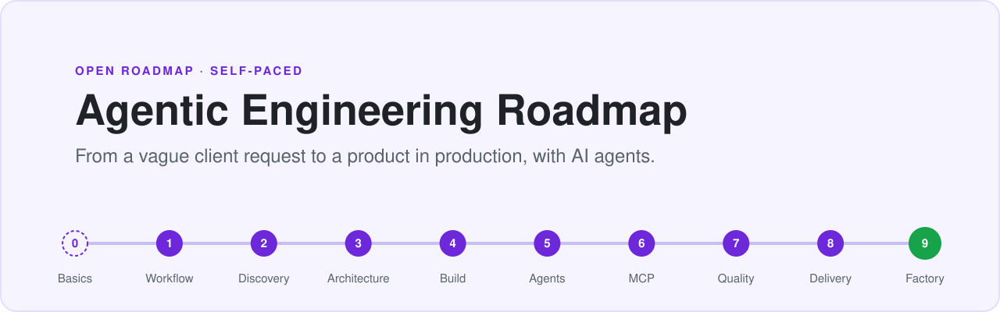
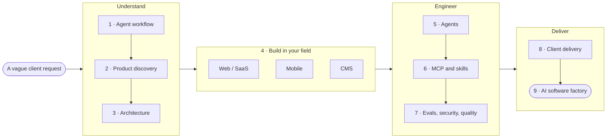
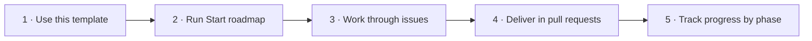

<picture>
  <source media="(prefers-color-scheme: dark)" srcset="assets/banner-dark.svg">
  
</picture>

<p align="center">
  
  
  
  
  
</p>

<p align="center">
  Created by <b>Abdelrahman Haridy</b>, Senior Software Developer · <a href="https://www.linkedin.com/in/abhar/">LinkedIn</a> · <a href="https://github.com/ab-haridy">GitHub</a>
</p>

---

## The idea in one minute

AI agents can write code fast. That isn't the hard part of client work any more. The hard part is everything around the code:

- **Understanding** what the client actually needs, when the request is vague.
- **Directing** agents with a clear plan, instead of letting them guess.
- **Verifying** what they produce, so it is safe to ship.
- **Delivering** a whole product a client can run, not a pile of features.

This roadmap trains those four skills on **real job descriptions**, one deliverable at a time, inside your own GitHub repository.

## The journey



You build **one product** in Phase 4, in your own field. In Phases 5 to 7 you keep improving that same product with agents, evals, security and quality gates. Phase 0 is an optional warm-up.

## How it works



| Step | What you do | What happens |
|:---:|---|---|
| **1** | Click **Use this template** → **Create a new repository** | You get your own copy. Keep it public as a portfolio, or private. |
| **2** | In your copy: **Actions** → **Start roadmap** → **Run workflow**. Choose your field and starting phase. | An issue is created for every module, and a milestone for every phase. |
| **3** | Open the next issue and read the module | Each module has an objective, a practical task, a deliverable and a Definition of Done. |
| **4** | Put your work in `work/` and open a pull request that closes the issue | The pull request template asks what you verified yourself and where you overrode the agent. |
| **5** | Merge it | The issue closes, and the phase's milestone shows how far you've got. |

## Who it is for

| ✅ A good fit if you… | ❌ Not a good fit if you… |
|---|---|
| Already build software in a field: web, mobile or CMS | Are learning to program for the first time |
| Read technical English comfortably | Want video lessons to watch from start to finish |
| Want to deliver whole products, not single features | Want a certificate more than a portfolio |
| Can give a few focused hours a week, on your own | Need someone to set your schedule |

## The roadmap

In total, about **210 to 320 hours**, depending on your field and where you start: roughly five to eight months at 10 hours a week. Each module states its own estimate.

| Phase | Modules |
|---|---|
| **0 · Agentic coding foundations** *(optional)* | [0.1 The agentic coding loop](modules/0.1-agentic-coding-loop/README.md)<br>[0.2 Repository context and agent instructions](modules/0.2-repository-context/README.md)<br>[0.3 Verification-first development](modules/0.3-verification-first/README.md) |
| **1 · AI-native delivery workflow** | [1.1 Requirement to verified code: a repeatable agent workflow](modules/1.1-agent-workflow/README.md) |
| **2 · Product discovery** | [2.1 Turn a job description into a product brief](modules/2.1-product-brief/README.md)<br>[2.2 Run a requirements workshop](modules/2.2-requirements-workshop/README.md) |
| **3 · Architecture** | [3.1 System design, ADRs and agent-ready tasks](modules/3.1-architecture/README.md) |
| **4 · Field project** *(one, by field)* | [4.web Build a production-ready SaaS MVP](modules/4-web-saas-mvp/README.md)<br>[4.mobile Deliver a mobile product](modules/4-mobile-product/README.md)<br>[4.cms Deliver a CMS project](modules/4-cms-project/README.md) |
| **5 · Agent engineering** | [5.1 Workflows vs autonomous agents](modules/5.1-workflows-vs-agents/README.md)<br>[5.2 Context engineering and long-running tasks](modules/5.2-context-engineering/README.md)<br>[5.3 Orchestrator, workers and parallel work](modules/5.3-orchestrator-workers/README.md) |
| **6 · MCP and skills** | [6.1 Understand the Model Context Protocol](modules/6.1-understand-mcp/README.md)<br>[6.2 Build a custom MCP server](modules/6.2-build-mcp-server/README.md)<br>[6.3 Create a reusable skill](modules/6.3-reusable-skill/README.md)<br>[6.4 A skills library and your specialization playbook](modules/6.4-skills-library-and-playbook/README.md) |
| **7 · Evals, security and quality gates** | [7.1 Define success before optimizing the agent](modules/7.1-define-success/README.md)<br>[7.2 Regression testing for agent systems](modules/7.2-regression-testing/README.md)<br>[7.3 Safe agentic engineering](modules/7.3-safe-agentic-engineering/README.md)<br>[7.4 Quality gates: CI/CD, end-to-end tests and release readiness](modules/7.4-quality-gates/README.md) |
| **8 · Client delivery** | [8.1 From prototype to a production plan](modules/8.1-prototype-to-production/README.md)<br>[8.2 Proposal, milestones and handover](modules/8.2-proposal-and-handover/README.md) |
| **9 · Capstone: the AI software factory** | [9.1 Design the AI software factory](modules/9.1-design-the-factory/README.md)<br>[9.2 Implement the AI software factory](modules/9.2-implement-the-factory/README.md)<br>[9.3 Run a new job description end to end and ship](modules/9.3-ship-a-new-jd/README.md) |

## Practise on real job descriptions

Every project starts from a real job description, the way client work does. Find one on a freelance marketplace, or use one from the [`jds/`](jds/README.md) folder. Names and identifying details are removed.

## Free workshop

A live workshop walks through the roadmap so you can follow it on your own and get the most out of it. To join, you need:

1. English at **B2 or above** on the free [EF SET](https://efset.org/ef-set-50) test (50 minutes, reading and listening). You get a certificate link to share when you book.
2. Prior experience in your field

**[Book a seat on ADPList](https://adplist.org/mentors/abdelrahman-haridy?session=agentic-engineering-roadmap-ac7b-mvqqyv18)** and paste your EF SET certificate link in the booking note.

## Contributing

Found a problem, or have a good job description to suggest? See [CONTRIBUTING.md](CONTRIBUTING.md).

## Repository map

```text
.
├── modules/      one folder per module: the task, the deliverable, the Definition of Done
├── jds/          real job descriptions to practise on
├── work/         your deliverables go here
├── roadmap.json  the map the Start roadmap workflow reads
└── .github/      the Start roadmap workflow and the pull request template
```

## About the author


**Abdelrahman Haridy**<br>
Senior Software Developer · Riyadh, Saudi Arabia

<a href="https://www.linkedin.com/in/abhar/"></a> <a href="https://github.com/ab-haridy"></a>

<br clear="left">

Abdelrahman has been building and shipping software since 2015: more than 70 digital projects for clients, employers and his own products.

- **Builds:** web applications and admin dashboards in Angular, React and Next.js, NestJS back ends, WordPress, and Arabic right-to-left interfaces, including front ends on the Saudi Digital Government Authority (DGA) design system.
- **At scale:** has led front-end work on large platforms, including a global healthcare company's medical site serving 19 countries.
- **Products:** his templates and Angular components on Envato have sold 125 times.
- **Teaches:** has taught tech skills at several Egyptian universities, trained web developers at Egypt's Information Technology Institute (ITI) from 2016 to 2019, and is listed among the Top 50 front-end mentors on ADPList.

This roadmap puts that experience into one path: a real request, a clear brief, AI agents doing the heavy lifting, and every step verified before it ships.

## License

[CC BY-NC-SA 4.0](LICENSE). You may share and adapt this material for non-commercial use, with credit to Abdelrahman Haridy, under the same license. To cite it, use **Cite this repository** on the right.
